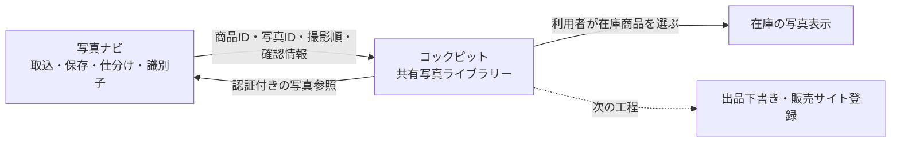

# 写真ナビ・販売コックピット 共通写真の土台

2026年11月12日。本人の「土台を作って進める」という指示に基づく第1段階。
写真の商品別仕分け・型番/JAN読取・TXT/Excel出力・既存の販売管理は維持する。

## 現在の操作

1. [写真ナビの商品一覧](https://photo-sorting-research.vercel.app/products)でプロジェクトを開き、共有する商品を選ぶ。
2. 「コックピットへ共有」を押す（1回50商品まで）。商品写真ページからは1商品を共有できる。
3. 受領を確認したら「共有写真を開く」を押す。[販売コックピットの共有写真](https://amazon-yahoo-inventory.vercel.app/?view=photos)へ進み、コックピットの本人アカウントでログインする。
4. 写真をクリックして同じ画面で拡大し、左右ボタン・左右キーで前後を見る。「写真一覧・代表写真を選ぶ」で使う写真を選ぶ。
5. 名前・ASIN・SKUを確認し、「関連付ける在庫商品」を明示して保存する。「在庫の代表写真に使う」は表示写真を変更したいときだけ選ぶ。在庫がまだない場合は既存の「コンテナ・自社在庫」で登録してから関連付ける。
6. 「コンテナ・自社在庫」から確認する。代表写真に指定した場合、在庫画面と対応が一意な全商品一覧に表示する。解除は共有写真カードの「この関連付けを外す」。

共有しただけで出品・Amazon画像登録・プライスター写真保存は完了しない。
共有済み写真を販売サイトへ実登録する機能は次の段階。

## データを保つ仕組み

- 写真本体は写真ナビの既存の非公開保管に1組だけ保持する。Google Drive・コックピットへの写真コピーは作らない。元のPC/SD写真も変更しない。
- 商品名やASINで自動統合しない。写真ナビの作業環境ID＋商品IDから共有商品のIDを決める。同じASINの別個体は別商品として残る。
- 写真ID、順序、元写真SHA256、保存写真SHA256、サイズ、型番/JANと確認状態を固定した写真セットを受け取る。JANは文字列で先頭0を保持する。
- 商品名・所属・メモ・読取結果を後から変更した場合、もう一度共有すると新しい版になる。既に在庫に関連付けた版を勝手に差し替えない。
- 再送は同じ写真セットとして受け取る。応答を失っても重複させない。異なる内容で同じ操作IDを再利用した場合は停止する。
- 在庫との関連付け時は写真と在庫の版を同一トランザクションで照合する。在庫本体の数量・価格・販路・下書きデータは書き換えない。
- 非公開写真はコックピットの本人認証後にサーバー経由で取得する。写真ナビとの専用署名は有効期間90秒、接続先は固定。DB/Blob/Authの資格情報は共有しない。取得画像は保存時のサイズ・SHA256と一致した場合だけ表示する。
- 共有済み・受領確認中の商品は自動整理の候補から外す。写真ページの「コックピットとの写真共有」から明示解除でき、解除後の再取得は停止する。既に画面に表示中の画像は画面更新まで残る。
- 在庫側の関連付け解除は写真の削除・共有解除とは別である。写真ナビ側の共有も解除するまで保管を継続する。自動削除そのものは従来どおり未稼働。

## 保存先とAPI

写真ナビ側の013マイグレーションで photo_share_packages / photo_share_assets を追加。
コックピットDBは app_storage.documents の photo-library を追加。既存の5業務文書とは別に保存する。

| 入口 | 認証・内容 |
| --- | --- |
| 写真ナビ POST /api/photo-shares | 本人＋同一Origin。商品と版を指定して共有／解除 |
| 写真ナビ GET /api/photo-shares | 本人。商品ごとの受領状態 |
| 写真ナビ GET /api/photo-packages/{package}/assets/{asset}/{preview,image} | 専用署名。共有に含まれる保存写真だけ |
| コックピット POST /api/photo-library/import | 専用署名。固定した作業環境から1〜50商品を受領 |
| コックピット GET /api/photo-library | 本人。受領商品と在庫関連付け一覧 |
| コックピット POST /api/photo-library/link | 本人＋同一Origin＋If-Match。在庫への関連付け・解除 |
| コックピット GET /api/photo-library/{package}/assets/{asset}/{preview,image} | 本人。保存サイズとSHAを照合して返却 |

契約は両リポジトリの shared/photo-bridge.mjs の photo-package/v1。
写真ナビ用は PHOTO_BRIDGE_KEY / PHOTO_BRIDGE_TARGET_ORIGIN、
コックピット用は PHOTO_BRIDGE_KEY / PHOTO_BRIDGE_SOURCE_ORIGIN / PHOTO_BRIDGE_WORKSPACE_ID。
秘密情報は既存のgitignore対象環境ファイルとVercel Productionだけへ保存する。
ローカルHTTP許可は独立QAプロセス内だけに設定する。

## 制限と次の工程

- 初期のDriveフォルダー参照だけの商品は、ツールが写真一式を保持していないため共有対象外。元写真を取り込む必要がある。小さな既存サムネイルだけを再利用した写真は「保存済みプレビュー」と表示する。
- コックピットの既存在庫へは自動名寄せせず、利用者が関連付ける。新しい在庫の自動作成、SKU確定、ASINの自動検索は行わない。
- 全商品一覧で複数の現物在庫が合流している場合は、写真を一意に決めず従来表示を保持する。
- 次はこの共有商品IDを使って、選択写真・状態・付属品を出品下書きへ渡す。写真ナビをプライスター・他販路にも使える入口として残す。
- Amazon Seller Central/中古出品写真、ヤフオクの実入力、スマホ取込はそれぞれ別の接続工程。外部保存先の権限と登録確認を販売用の履歴として分離する。

## 検証

- コックピット473テスト（新規11を含む）、写真ナビ72テスト、型チェック、本番ビルド成功。
- 独立QAで実際の非公開保管と両DBを使用。2枚の合成写真を、画面の共有ボタン→受領→拡大→2枚目選択→在庫関連付け→再読込→解除まで検証。
- 応答喪失後の再送、JAN先頭0、写真順、未認証拒否、共有解除後410、保管候補除外を確認。在庫7個と元の商品情報、既存業務文書は不変。
- QA証跡と公開後照合は output/photo-bridge-20261112/。本番の実商品を試験用に作成しない。
